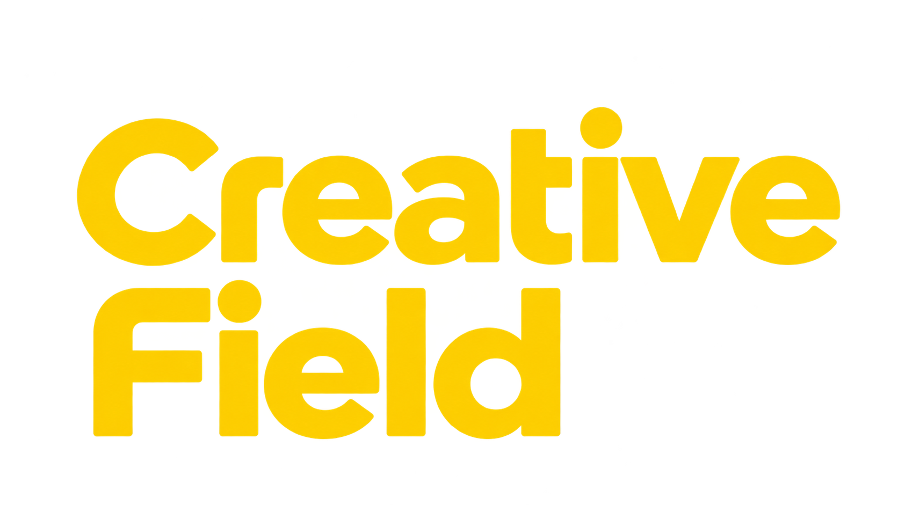
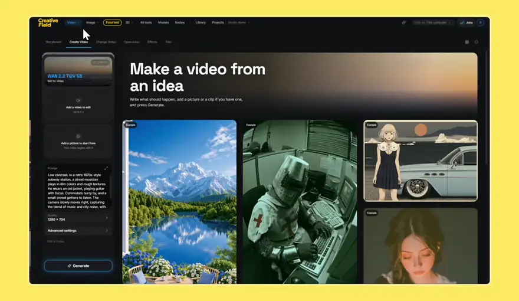
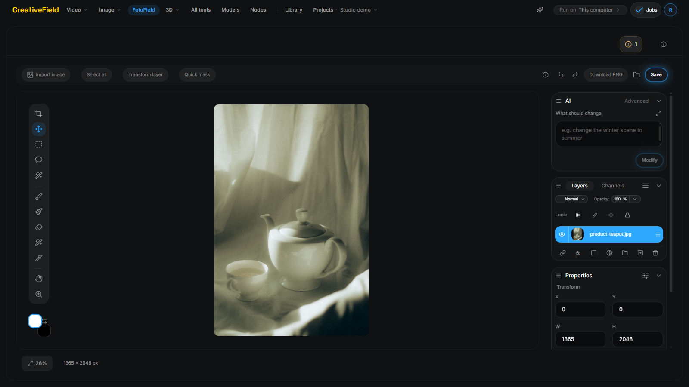
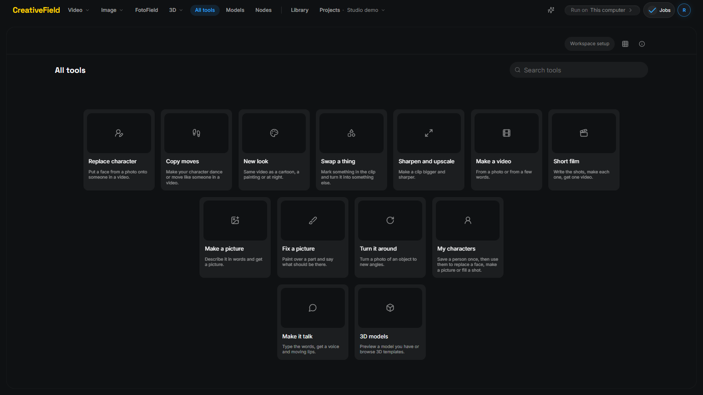
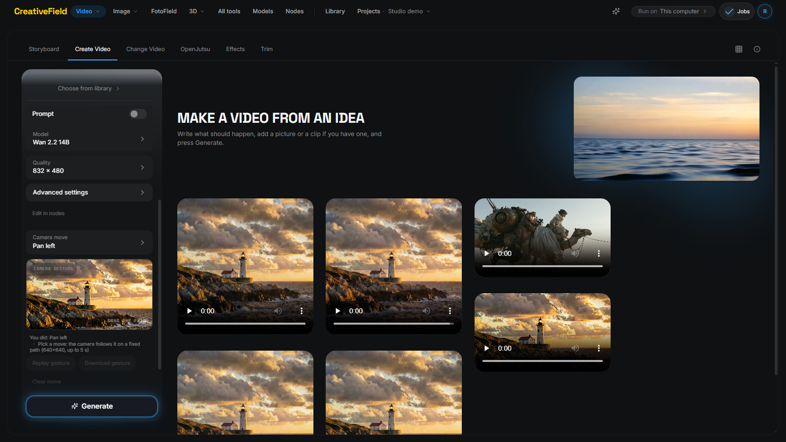
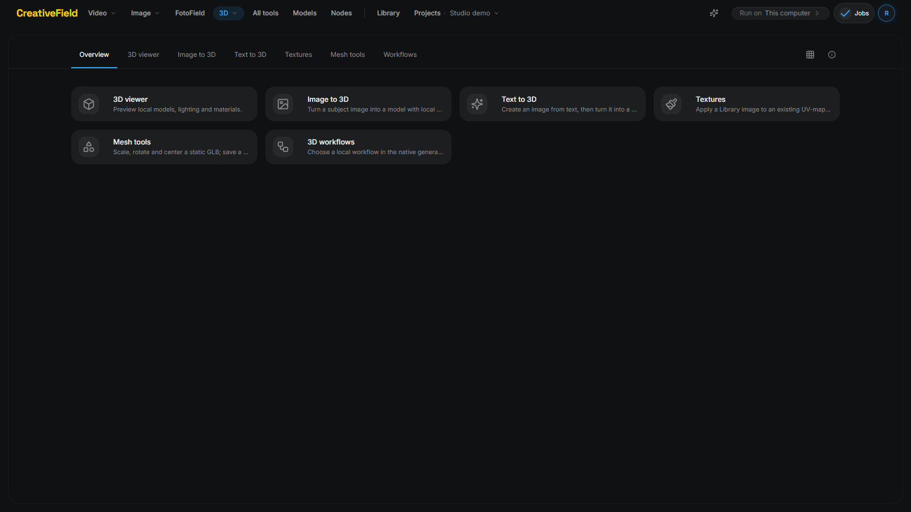

<div align="center">
  

  

  # CreativeField

  **A free, open-source, AI-powered Photoshop alternative, and a simple studio for ComfyUI video, image and 3D. It runs on your own computer.**
</div>

**Demo video (2 min):** link added at submission. Made for the [#OpenSourceHiggsfield](https://comfy.org/open-source-higgsfield/) challenge.

## Why CreativeField

Having a pro-grade palette at your fingertips, and every feature ComfyUI brings with it, does not mean you need a toolbox with all the equipment in it. Most of the time the work comes down to a few core moves: you start from an input and you want a video, a picture, or an edit of a picture. CreativeField is built around exactly those moves.

Along the way we built our own free, open-source, AI-powered alternative to Photoshop. It runs locally, and it works.

**Everything connects.** CreativeField is meant to cover a whole workflow, not a list of separate tools. Make a picture, then edit it. Use it as the reference for a video, or turn it into a 3D model. Use that 3D model as the reference for the next picture or video edit, and keep going. We will keep extending it towards the top ten film-creation tools and the most important photo-editing goals, all working together.

**Nodes you can read.** We reworked how ComfyUI nodes look, so a graph is clearer and easier to use, with a short description that tells you what each node does.

**Your workflows become apps.** Download a workflow or build your own, and CreativeField turns it into an app in the matching category: Video, Image or 3D.

We are open to ideas. Open an issue and tell us what you would like to see next.



**FotoField**, our image editor, has layers, masks, selections, smart objects, blend modes, crop, transform and brushes, and its AI tools (modify, magic eraser, subject select) run through ComfyUI on your machine. No subscription and no account; nothing leaves your computer unless you choose a cloud route. The rest of CreativeField puts the same idea around video, image and 3D: each tool is a real ComfyUI workflow behind a plain panel, and you can open the graph when you want it.

It is an early preview, not a Photoshop clone. FotoField covers the everyday layered-editing and AI-editing path; it does not yet match Photoshop's depth (see [Current limits](#current-limits)).

## Status

| | |
| --- | --- |
| **Apps** | More than 40 workflow folders in `native-workflows/` plus the official-template pipelines in `pipelines/`, each with a manifest that binds the simple panel to the graph. |
| **Built with ComfyUI** | Every generation runs in your ComfyUI. Cloud routes (Comfy Cloud, Comfy Router) exist but are optional and have not been proven end to end. |
| **Proven on this machine** | Windows 10, RTX 4090, 64 GB RAM: camera moves (measured), optional end image on Wan 2.2 14B, masked video edits, character replace (experimental), Image to 3D, maskless photo edits. |
| **Not proven** | macOS and Linux, a clean install on a fresh machine, the cloud routes, output quality on other hardware. |

## Apps

| App | What it does | Models | Status |
| --- | --- | --- | --- |
| **FotoField** | Layered photo editor with AI modify, magic eraser, subject select and masks | FLUX.2 Klein edit, Qwen Image 2.1 edit, SAM 3.1 | Working; the AI part needs the image-edit workflow installed |
| **Create Video** | Photo or words to video; camera moves on a fixed path; optional end image | Wan 2.2 14B I2V, Wan 2.2 Fun Camera, Wan 2.2 TI2V 5B | Camera moves measured on real clips |
| **Change Video** | New look, swap a thing, copy moves, replace character, sharpen and upscale | Wan 2.1 VACE, SAM 3.1, SCAIL-2, Wan Animate 2, Real-ESRGAN | Working; replace character is experimental |
| **Image** | Make a picture, turn an object to new angles, relight | FLUX.2 Klein, Qwen Image 2.1 | Working |
| **3D** | Image to 3D, Text to 3D, viewer, textures, mesh tools | Hunyuan3D 2.1, TRELLIS.2 | Working |
| **Short film** | Write the shots, make each one, get one video | Wan 2.2 plus FFmpeg assembly | Assembly works; identity can drift between shots |
| **Import a workflow** | Turn a saved ComfyUI workflow into a simple panel | any allowed node set | Working for reviewed nodes |

## Screenshots







The screenshots show the real application in a demo project. They show the interface, not a claim about output quality.

### Camera moves are checked, not hoped for

A sentence like "the camera pans left" in a prompt is a wish the model may ignore: measured on a real run, it moved the picture by 0.5 %. CreativeField therefore runs a camera move on the Wan 2.2 Fun Camera model, which takes a fixed camera path. On real three-second clips the picture moved 11.6 % (pan left) and 7.6 % (zoom in). `scripts/camera-check.mjs` measures any clip this way, and `scripts/motion-check.mjs` tells a living clip from a still one.

## Run it

**Requirements:** Node.js 22 or newer, a desktop browser at 1280 × 720 or larger, and ComfyUI on the same machine for generation. Models and custom nodes are installed separately and have their own hardware needs and terms.

1. Install [ComfyUI](https://github.com/comfyanonymous/ComfyUI). The Windows portable build works. To start it from here, set `COMFY_HOME` to its folder and run `scripts/start-comfy.bat`.
2. From this folder:

```bash
npm install
npm start
```

3. Open [the local studio](http://127.0.0.1:8787). The first start prepares the app and its database.
4. Open **Models**, pick a workflow and check what it needs. An online worker alone does not mean its models and nodes are installed.
5. Choose a tool in **All tools**, add your inputs and press **Generate**.

FotoField works without any model for everything except the AI buttons. Copy `.env.example` to `.env` to change ports, storage or the cloud key.

## Add an app

Every app is a folder in `native-workflows/` with a ComfyUI graph (`template.api.json`) and a `manifest.json` that says which node fields the panel exposes. We do not rewrite graphs: an app is an official, hub or your own ComfyUI workflow with a simplified front. You can also import a saved workflow in the app; it keeps only the controls it needs inline and leaves the rest under **Advanced**.

## Connections and data

Local generation uses your configured ComfyUI worker. Cloud is optional: select a supported connection and check the model, account access and cost before submitting anything. Cloud runs can send selected inputs to the provider and can consume credits. A ChatGPT subscription should not be assumed to support every image-editing operation.

Keep generated runtime configuration, credentials, account profiles, project data and backups private. Never include them in a source contribution.

## Current limits

- **FotoField is not Photoshop.** It has layers, masks, smart objects, selections, blend modes, crop and transform, but no CMYK, no raw development, no plug-in ecosystem and fewer filters and adjustment layers.
- **Replace character is experimental.** Reference fidelity, multi-person replacement, the still-to-video handoff and overlay cleanup need further visual qualification.
- **Cloud and OpenJutsu need end-to-end qualification.** A visible panel or a compatible protocol does not establish successful generation for your account.
- **3D:** the native Image to 3D panel is integrated; other 3D tools remain editor/template entry points. This UI work did not requalify model outputs.
- **Not yet rehearsed:** a clean install on a fresh machine, and macOS or Linux.

## Development

```bash
npm run build
npm run server:check
```

Contributions should include screenshots made with nonprivate demo content for interface changes. Keep existing workflows and permission boundaries intact.

## Credits and licenses

Application code: [GNU GPL version 3](LICENSE) (`GPL-3.0-only`), copyright **bashpacks**. External components and model weights retain their own terms; see the [workflow license inventory](docs/LICENSE-INVENTORY.md). The application license does not grant rights to third-party models, nodes or media.

The pictures and clips on the tool cards and heroes are AI-generated with Midjourney by the author; the FotoField card uses a Pexels photo (see `fixtures/real/SOURCES.md`).

Made by **bashpacks**.
