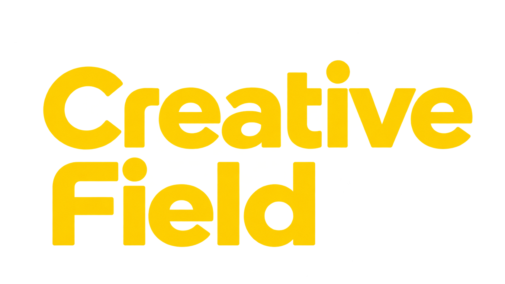
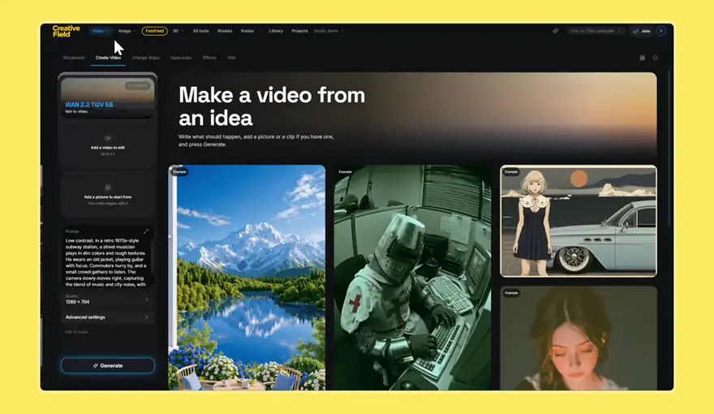
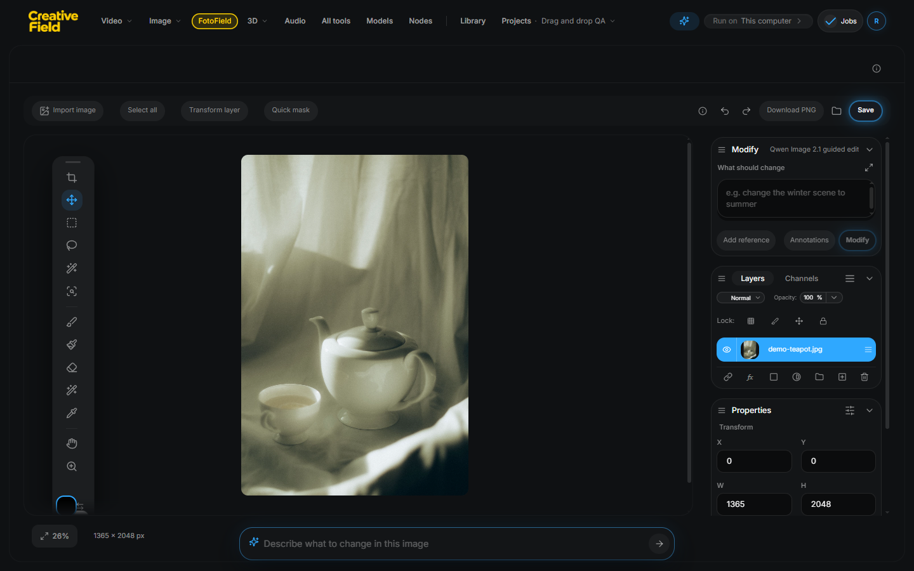
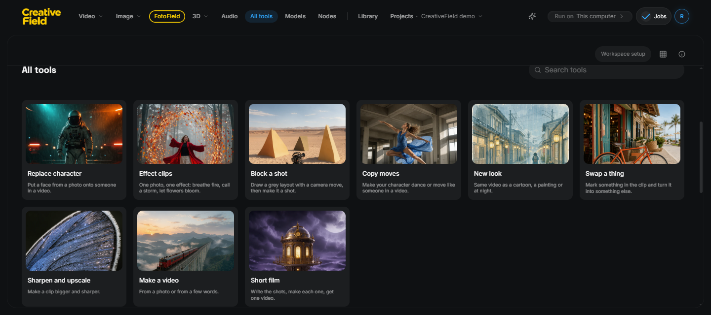
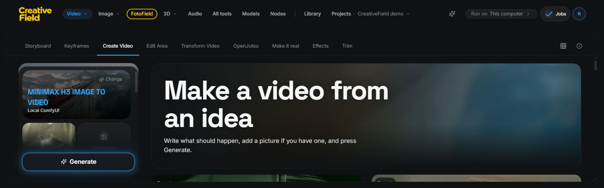
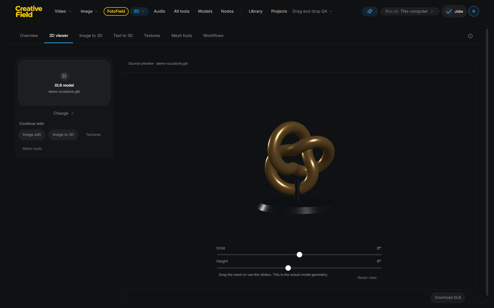

<div align="center">
  

  

  # CreativeField

  **An open-source creative studio for ComfyUI image, video and 3D workflows. Local generation uses models installed separately.**
</div>

Made for the [#OpenSourceHiggsfield](https://comfy.org/open-source-higgsfield/) challenge.

## Why CreativeField

Having a pro-grade palette at your fingertips, and every feature ComfyUI brings with it, does not mean you need a toolbox with all the equipment in it. Most of the time the work comes down to a few core moves: you start from an input and you want a video, a picture, or an edit of a picture. CreativeField is built around exactly those moves.

FotoField provides a growing set of layered image-editing tools alongside AI-assisted operations.

**Everything connects.** CreativeField is meant to cover a whole workflow, not a list of separate tools. Make a picture, then edit it. Use it as the reference for a video, or turn it into a 3D model. Use that 3D model as the reference for the next picture or video edit, and keep going. We will keep extending it towards the top ten film-creation tools and the most important photo-editing goals, all working together.

**Nodes you can read.** We are reworking how ComfyUI nodes look, so a graph is clearer and easier to use. A first design preview is in the app; the goal is a short description on every node that tells you what it does.

**Workflows as apps.** Import a compatible workflow and configure its inputs as an app. Support depends on the graph, its nodes and the installed models; not every workflow can be converted automatically.

We are open to ideas. Open an issue and tell us what you would like to see next.



**FotoField**, our image editor, has layers, masks, selections, smart objects, blend modes, crop, transform and brushes, and its AI tools (modify, magic eraser, subject select) run through ComfyUI on your machine. Local editing does not require a subscription or account. Cloud routes send selected inputs to their provider. CreativeField also offers video, image and 3D tools backed by local workflows or optional cloud routes. Availability depends on the installed models and nodes.

It is an early preview, not a Photoshop clone. FotoField covers the everyday layered-editing and AI-editing path; it does not yet match Photoshop's depth (see [Current limits](#current-limits)).

## Status

| | |
| --- | --- |
| **Apps** | More than 40 workflow folders in `native-workflows/` plus the official-template pipelines in `pipelines/`, each with a manifest that binds the simple panel to the graph. |
| **Built with ComfyUI** | Local generation uses ComfyUI. Optional cloud routes send the selected media to their provider; their availability depends on the connection and model. |
| **Proven on this machine** | Selected workflows have been exercised locally on Windows; model availability and output quality vary. |
| **Not proven** | macOS and Linux, a clean install on a fresh machine, the cloud routes, output quality on other hardware. |

## Apps

| App | What it does | Requirements |
| --- | --- | --- |
| **FotoField** | Layered image editing, selections, masks and AI-assisted modifications | Image workflows and models must be installed separately; results vary. |
| **Create Video** | Generate video from a prompt or image, with camera guidance where supported | Local H3 workflows and required ComfyUI nodes must be installed. |
| **Change Video / OpenJutsu** | Restyle or replace elements in a source video | Availability and quality depend on the workflow, inputs and installed model. |
| **Image** | Generate, edit, relight and explore camera angles | FLUX Klein, Qwen Image and Fibo workflows depend on their installed models. |
| **Storyboard and Keyframes** | Plan shots, configure frames and assemble generated clips | Requires compatible video workflows and FFmpeg. |
| **3D** | Explore the available 3D workflows and viewer | Requires separate compatible models and nodes. |
| **Import a workflow** | Open a saved ComfyUI workflow through a simplified panel | Supported inputs depend on the workflow and available nodes. |

## Screenshots







The screenshots show the real application in a demo project. They show the interface, not a claim about output quality.

### Camera guidance

Camera settings and prompts are guidance to the selected workflow. Their effect depends on the model and input; a requested move is not guaranteed.

## Run it

**Requirements:** Node.js 22 or newer, a desktop browser at 1280 × 720 or larger, and ComfyUI on the same machine for generation. Models and custom nodes are installed separately and have their own hardware needs and terms.

1. Install [ComfyUI](https://github.com/comfyanonymous/ComfyUI). The Windows portable build works. To start it from here, set `COMFY_HOME` to its folder and run `scripts/start-comfy.bat`.
2. From this folder:

```bash
npm install
npm start
```

3. Open [the local studio](http://127.0.0.1:8787). The first start prepares the app and its database.
4. Open **Models**, pick a workflow and check what it needs. An online worker alone does not mean its models and nodes are installed.
5. Choose a tool in **All tools**, add your inputs and press **Generate**.

FotoField editing tools do not require a model, but its AI features do. The one-command local start creates its own configuration; for manually managed server deployments, copy `.env.example` to `.env` and configure it there.

### Model downloads

Model weights are not included in this repository. Download the files required by the workflow you choose and place them in the ComfyUI model folders described in that workflow's manifest and in **Models**. The main model families are:

- [FLUX Klein for ComfyUI](https://huggingface.co/black-forest-labs/flux-3-image-klein-comfy)
- [Fibo 2.0 for ComfyUI](https://huggingface.co/Comfy-Org/Fibo-2.0)
- [Qwen Image 2.1 for ComfyUI](https://huggingface.co/Comfy-Org/Qwen-Image-2.1)
- [MiniMax H3 for ComfyUI](https://huggingface.co/Comfy-Org/MiniMax-H3)

Individual workflows may need additional custom nodes, text encoders or other assets. Consult their manifests and the model providers' license terms; for example, the Fibo 2.0 distribution is non-commercial.

## Add an app

Every app is a folder in `native-workflows/` with a ComfyUI graph (`template.api.json`) and a `manifest.json` that says which node fields the panel exposes. Built-in apps may adapt official or community graphs; their manifests and license inventory describe their sources. An app exposes a ComfyUI workflow through a simplified front. You can also import a saved workflow in the app; it keeps only the controls it needs inline and leaves the rest under **Advanced**.

## Connections and data

Local generation uses your configured ComfyUI worker. Cloud is optional: select a supported connection and check the model, account access and cost before submitting anything. Cloud runs can send selected inputs to the provider and can consume credits. A ChatGPT subscription should not be assumed to support every image-editing operation.

Keep generated runtime configuration, credentials, account profiles, project data and backups private. Never include them in a source contribution.

## Current limits

- **FotoField is not Photoshop.** It has layers, masks, smart objects, selections, blend modes, crop and transform, but no CMYK, no raw development, no plug-in ecosystem and fewer filters and adjustment layers.
- **Replace character is experimental.** Reference fidelity, multi-person replacement, the still-to-video handoff and overlay cleanup need further visual qualification.
- **Cloud and OpenJutsu need end-to-end qualification.** A visible panel or a compatible protocol does not establish successful generation for your account.
- **3D:** the native Image to 3D panel is integrated; other 3D tools remain editor/template entry points. This UI work did not requalify model outputs.
- **Not yet rehearsed:** a clean install on a fresh machine, and macOS or Linux.

## Development

```bash
npm run build
npm run server:check
```

Contributions should include screenshots made with nonprivate demo content for interface changes. Keep existing workflows and permission boundaries intact.

## Credits and licenses

Application code: [GNU GPL version 3](LICENSE) (`GPL-3.0-only`), copyright **bashpacks**. External components and model weights retain their own terms; see the [workflow license inventory](docs/LICENSE-INVENTORY.md). The application license does not grant rights to third-party models, nodes or media.

The included examples illustrate the interface. Fixture photo and video sources are listed in `fixtures/real/SOURCES.md`.

Made by **bashpacks**.
